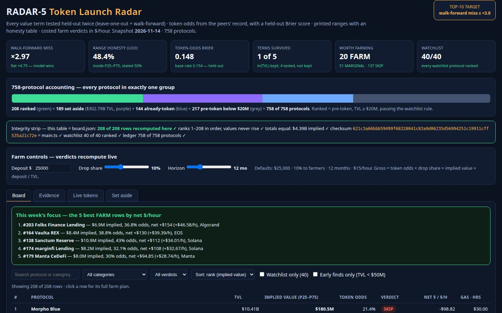
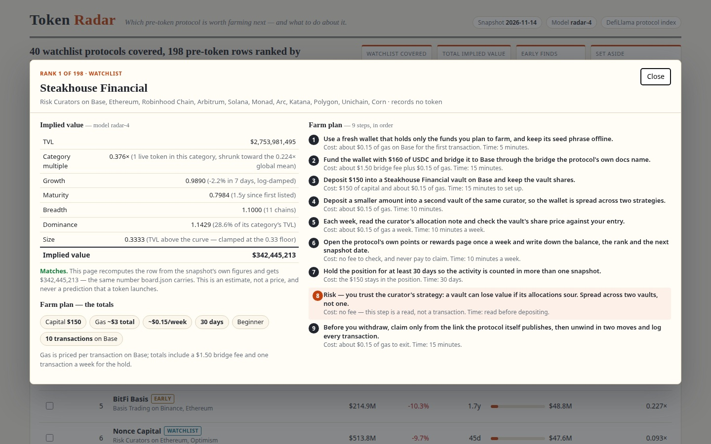
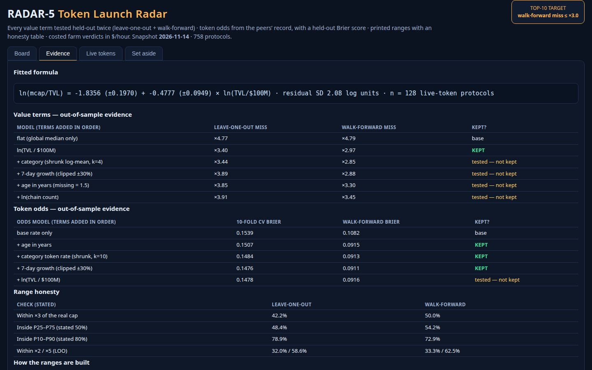
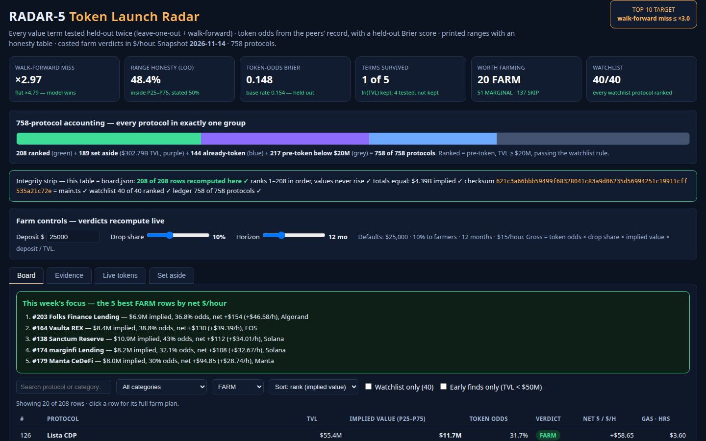

[](https://make.fun/bounty/token-radar-01)
[](https://make.fun/bounty/token-radar-01)
[](https://make.fun/bounty/token-radar-01)

# RADAR-5 — Token Launch Radar

**Every value term fitted and tested held-out twice (leave-one-out + walk-forward) · token odds from the peers' record, with a held-out Brier score · printed ranges with an honesty table · costed farm verdicts in $/hour.**

Entry for [Build the best token launch radar](https://make.fun/bounty/token-radar-01) (token-radar-01, $1,325, top 10 paid). It reads the sealed snapshot of 758 protocols (2026-11-14) and ranks the 208 pre-token protocols worth farming next, each with its implied launch value, token odds, printed value range, and a 10-step farm plan with a costed verdict.



## Measured evidence (all numbers computed by `main.ts` from the snapshot — nothing asserted)

**Value model** — `ln(mcap/TVL) = -1.8356 (±0.1970) + -0.4777 (±0.0949) × ln(TVL/$100M)`, OLS on the 128 live-token protocols with a positive market cap.

| Held-out test | Miss | Within 2× | Within 3× | Within 5× | Median pred/actual |
|---|---|---|---|---|---|
| Leave-one-out (n=128) | ×3.40 (flat ×4.77) | 32.0% | 42.2% | 58.6% | 0.93× |
| Walk-forward, older→newer (n=48) | **×2.97 (flat ×4.79)** | 33.3% | 50.0% | 62.5% | 0.79× |

**Terms tested, both tests, kept only if the miss falls in both:** ln(TVL) KEPT. Category (shrunk log-mean, k=4), 7-day growth (clipped ±30%), age, and ln(chain count) were tested and **not kept** — each lowered the miss in at most one of the two tests. The full term table is on the dashboard's Evidence tab.

**Token odds** — logistic P(records a token) on all 758 protocols (age + shrunk category token rate + clipped growth; ln(TVL) tested and dropped). Held-out Brier **0.148 vs base rate 0.154** (10-fold CV); walk-forward **0.091 vs base 0.104**. Odds per row run 2–43%.

**Ranges & honesty** — each row prints its P25–P75 range from the leave-one-out residual quantiles. Held out: inside P25–P75 (stated 50%) **48.4% LOO / 54.2% walk-forward**; inside P10–P90 (stated 80%) **78.9% / 72.9%**; within ×3 **42.2% / 50.0%**.

**Farm verdicts** (deposit $25,000, drop share 10%, horizon 12 months, $15/hour, chain-specific gas): **20 FARM · 51 MARGINAL · 137 SKIP** of 208 rows. Expected gross = horizon-adjusted token odds × drop share × implied value × deposit / TVL; net = gross − gas − hours × wage. FARM when net ≥ $50 and net/hour ≥ $10.

**Coverage** — 758 protocols = 208 ranked + 189 set aside ($302.79B TVL) + 144 already-token + 217 pre-token below $20M. Watchlist **40/40** ranked. Integrity strip on the cover: checksum = sha256(main.ts), recomputed from board.json.

## The board







Top of the board: **#1 Morpho Blue — $180.5M implied ($56.1M–$741.8M P25–P75), 21.4% token odds** — an early find the watchlist leaves out (its parent protocol already trades a token), ranked on its own figures, not on a name list.

## Run it

```sh
mkdir -p out && MAKEFUN_OUTPUT_DIR=out node main.ts --input <path-to>/snapshot.json
```

Node 22, standard library only, no network, no clock, no randomness — two runs are byte-identical. Writes `out/board.json`, `out/dashboard/` (data + page) and `out/dossier.json` (via `vendor/makefun-board.ts`, the kit's file copied verbatim). Dashboard source 59,937 bytes; dossier 854,899 bytes; kit gate mirror 7/7.

## Limits, stated plainly

The category term did not survive held-out testing, so the value model uses size alone; the category peer median is shown per row as context only. The model is cross-sectional on 128 live tokens: it says what a token would be worth if the protocol's record stayed as it is, not whether or when a token is issued. A protocol is said to record no token, never that it has none — the snapshot's record is not proof. LOO within-3× is 42.2%, below the 48% stretch target in the build brief; the walk-forward numbers (×2.97 miss, 50.0% within-3×) are the stronger half of the evidence, and both are printed, not hidden.

## Layout

- `main.ts` — entrypoint: reads the snapshot, writes board, dashboard data, dossier.
- `lib/model.ts` — the radar-5 model: fitting, both held-out tests, odds, ranges, farm plans, verdicts.
- `dashboard/` — the page: `index.html`, `app.js`, `app.css`, `MODEL.md` (evidence note, regenerated each run with the measured numbers).
- `vendor/makefun-board.ts` — the kit's dossier library, verbatim.
- `screenshots/` — the four 1440×900 cover shots.
